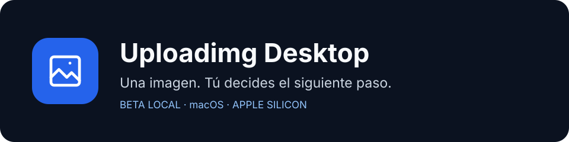

<p align="center">
  
</p>

<p align="center">
  
  
  
</p>

# UploadIMG Desktop

Copia una imagen, revisa su vista previa y compártela desde la barra de menús de
macOS. UploadIMG solo sube una imagen cuando pulsas **Compartir**: la beta
**0.1.0-beta.4** usa `https://uploadimg.vercel.app` y muestra el enlace cuando el
servidor confirma la publicación. Los enlaces caducan a las 24 horas.

## Descargar e instalar

[**Descargar v0.1.0-beta.4 para macOS Apple Silicon**](https://github.com/SergioGMR/uploadimg-desktop/releases/download/v0.1.0-beta.4/UploadIMG-0.1.0-beta.4-macos-arm64.dmg)
· [Notas y SHA256SUMS](https://github.com/SergioGMR/uploadimg-desktop/releases/tag/v0.1.0-beta.4)

1. Descarga el DMG y `SHA256SUMS` desde la misma Release. Ejecuta
   `shasum -a 256 UploadIMG-0.1.0-beta.4-macos-arm64.dmg` y compara el resultado.
2. Abre el DMG y arrastra **UploadIMG** a **Aplicaciones**.
3. Cierra cualquier versión anterior, abre UploadIMG y usa su icono en la barra de menús.

El bundle debug tiene firma local ad-hoc, sin certificado de distribución Apple
ni notarización. Si macOS bloquea la apertura, tras verificar origen y checksum
puedes usar la opción que ofrezca **Ajustes del Sistema → Privacidad y seguridad**.

Desde beta.1/beta.2, instala beta.4 manualmente. Desde beta.3 puedes usar
**Buscar actualizaciones** y confirmar la instalación; antes finaliza o descarta
las imágenes y subidas pendientes. Consulta los
[límites y la evidencia del actualizador](docs/automatic-updates.md).

## Uso

| Acción | Resultado |
| --- | --- |
| **Pegar imagen** | Selecciona una imagen del portapapeles mediante una acción explícita. |
| **Detectar imágenes copiadas** | Admite nuevas imágenes copiadas y muestra su vista previa. |
| **Compartir** | Sube la imagen seleccionada y obtiene su enlace. |
| **Ignorar** | Descarta la candidata. |
| **Generar imagen sintética** | Prueba el flujo con una imagen de demostración. |
| **Pausar / Salir** | Detiene temporalmente la detección o cierra la aplicación. |

La detección empieza **desactivada** en una instalación nueva. Beta.4 recuerda
la elección de activarla o desactivarla en las preferencias locales de macOS;
pausar es temporal. Al restaurar la detección solo admite imágenes nuevas. Si
una lectura se deniega o no está disponible, la detección queda desactivada.

El atajo de macOS **Control + Command + Shift + 4** copia una captura al
portapapeles. UploadIMG no instala un atajo global ni captura la pantalla por su
cuenta. Cerrar la ventana mantiene el proceso en la barra de menús; usa
**Abrir UploadIMG** para volver a ella.

Solo se persiste el booleano de detección en `UserDefaults`. Imágenes, vistas
previas, enlaces e información para reintentar subidas viven en memoria y se
pierden al cerrar el proceso. Las imágenes publicadas permanecen en el servidor
hasta su caducidad. La detección de carpetas todavía no está disponible.

## Estado de la beta

La distribución disponible es para **macOS Apple Silicon**. La CI de beta.4
construyó y comprobó los paquetes en macOS 26.6.2 arm64; las descargas públicas
coincidieron con los artefactos revisados. La confirmación gráfica de actualización,
el reinicio automático, las preferencias mediante GUI, Gatekeeper y la recuperación
ante un fallo real de instalación siguen pendientes. Los checks de empaquetado y
el reemplazo headless no validan esos casos.

macOS Intel, otras versiones de macOS y la aplicación completa en Windows/Linux
siguen sin verificar. El mínimo macOS 15.4 del plist es metadato, no soporte probado.
Consulta [los detalles técnicos y los límites de validación](desktop/README.md)
y [la evidencia de beta.4](docs/automatic-updates.md#beta4-release-evidence).
La [beta.1 histórica](https://github.com/SergioGMR/uploadimg-desktop/releases/tag/v0.1.0-beta.1)
solo compartía enlaces simulados en `example.invalid`; beta.4 realiza subidas reales.

## Desarrollo y contribuciones

El núcleo está escrito en Rust, la integración macOS en Swift y la interfaz local
en HTML/CSS/JavaScript con Tauri. Desde la raíz del repositorio, con el toolchain
y las dependencias descritos en [la guía de desarrollo](desktop/README.md):

```sh
bash desktop/scripts/test.sh
bash desktop/scripts/build.sh
open "desktop/.build/UploadIMG.app"
```

Consulta [cómo contribuir](CONTRIBUTING.md),
[la publicación de versiones](docs/releasing.md) y
[la procedencia del backport GLib](docs/glib-backport.md).
Los documentos de arquitectura/API en `docs/` incluyen propuestas todavía sin implementar.
Para errores o propuestas, [abre una issue](https://github.com/SergioGMR/uploadimg-desktop/issues/new/choose).

## Autoría y licencia

Proyecto de [SergioGMR](https://github.com/SergioGMR).
Copyright © 2026 SergioGMR. El material original del proyecto se distribuye bajo
**GNU GPL versión 3 únicamente**
([GPL-3.0-only](https://spdx.org/licenses/GPL-3.0-only.html)); consulta
[LICENSE](LICENSE) y [COPYRIGHT](COPYRIGHT).

Puedes usarlo, estudiarlo, modificarlo y crear forks, también para uso comercial
o venta. Al redistribuirlo, conserva los avisos de autoría y licencia. Si distribuyes
una versión modificada cubierta por la GPL, indica los cambios y sus fechas,
licénciala bajo GPL-3.0-only y proporciona a sus receptores el **Código Fuente
Correspondiente** conforme a la licencia. Los cambios privados no requieren
publicación; la GPL no impone la obligación de fuente por el mero uso a través de una red.
Se ofrece sin garantía, según los términos de la licencia.

Los componentes de terceros conservan sus propias licencias y avisos; los de las
dependencias de Rust para macOS están en [THIRD-PARTY-NOTICES](THIRD-PARTY-NOTICES), que
se incluye en las compilaciones nuevas (a partir de 0.1.0-beta.5; las versiones ya
publicadas no cambian). En particular, el GLib vendorizado mantiene su
[licencia MIT](desktop/vendor/glib-0.18.5/LICENSE)
y [COPYRIGHT original](desktop/vendor/glib-0.18.5/COPYRIGHT).
