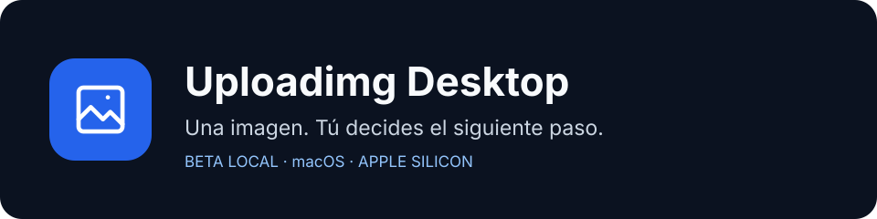

<p align="center">
  
</p>

<p align="center">
  
  
  
</p>

# Tu siguiente imagen, a un clic

UploadIMG vive en la barra de menús de macOS. Copia una imagen, revisa
su vista previa y decide qué hacer con ella. La detección del portapapeles es
opcional y empieza **desactivada en cada inicio**.

**La beta 0.1.0-beta.3 incluye subidas reales** a
`https://uploadimg.vercel.app`: revisa la imagen y pulsa **Compartir** para enviarla.
El enlace aparece después de que el servidor confirme la publicación y caduca a las 24 horas.

## Descargar la beta

[**Descargar v0.1.0-beta.3 para macOS arm64**](https://github.com/SergioGMR/uploadimg-desktop/releases/download/v0.1.0-beta.3/UploadIMG-0.1.0-beta.3-macos-arm64.dmg)
· [Notas y SHA256SUMS](https://github.com/SergioGMR/uploadimg-desktop/releases/tag/v0.1.0-beta.3)

1. Descarga el DMG y `SHA256SUMS` desde la misma Release.
2. Comprueba el archivo: `shasum -a 256 UploadIMG-0.1.0-beta.3-macos-arm64.dmg`
   y compara el resultado con su línea en `SHA256SUMS`.
3. Abre el DMG y arrastra **UploadIMG** a **Aplicaciones**.
4. Abre la aplicación y usa su icono de imagen en la barra de menús.

Beta.3 es la primera versión con actualizador: desde beta.1/beta.2 hay que
instalarla manualmente. Después puede consultar el canal beta mediante
**Buscar actualizaciones**. El manifiesto del canal apunta a beta.3; al consultar
esa misma versión se espera el estado «Tu versión está al día». La consulta
desde la app y la instalación de una versión posterior requieren sus propias
pruebas; no quedan demostradas por publicar este manifiesto.

El bundle debug lleva firma local ad-hoc, sin certificado de distribución Apple ni
notarización. macOS puede bloquear su apertura; si decides continuar tras
verificar origen y checksum, usa la opción de apertura que ofrezca
**Ajustes del Sistema → Privacidad y seguridad**.

La [beta.1 histórica](https://github.com/SergioGMR/uploadimg-desktop/releases/tag/v0.1.0-beta.1)
solo compartía enlaces simulados en `example.invalid`. Sus instaladores y los de
[beta.2](https://github.com/SergioGMR/uploadimg-desktop/releases/tag/v0.1.0-beta.2)
se conservan.

## Desarrollo local

La versión **0.1.0-beta.3** se publicó el **10 de octubre de 2026**, con DMG y
artefactos de actualización firmados. Sus nueve assets se descargaron por HTTPS
sin autenticación y coincidieron con los candidatos revisados.
Consulta [el estado y los límites de las actualizaciones](docs/automatic-updates.md).

```sh
bash desktop/scripts/test.sh
bash desktop/scripts/build.sh
open "desktop/.build/UploadIMG.app"
```

La app se instala como **UploadIMG**, con un icono propio basado en la web.
El identificador de la aplicación se conserva. Cierra la versión anterior antes de
abrir o instalar UploadIMG para evitar dos procesos a la vez.

## Del portapapeles a la vista previa

| Acción | Qué ocurre |
| --- | --- |
| Generar imagen sintética | Prueba el flujo con una imagen de demostración. |
| Activar detección | Admite nuevas imágenes copiadas y muestra su vista previa. |
| `Control + Command + Shift + 4` | El atajo de macOS copia una captura al portapapeles. |
| Pegar imagen | Admite una imagen mediante una acción explícita. |
| Ignorar / Compartir | Descarta la candidata o sube la imagen al servicio. |
| Pausar / Salir | Detiene la detección temporalmente o cierra la aplicación. |

Cerrar la ventana mantiene el proceso en la barra de menús. Las imágenes y los
resultados y capacidades de recuperación viven en memoria; se descartan al terminar
el proceso. Las imágenes ya publicadas permanecen en el servidor hasta su caducidad. La aplicación
no instala un atajo global ni captura la pantalla por su cuenta.

## Disponibilidad y desarrollo

La [CI de beta.3](https://github.com/SergioGMR/uploadimg-desktop/actions/runs/38066375725)
pasó 137 checks y construyó los paquetes en **macOS 26.6.2 arm64**; dos pruebas
de integración opt-in se omitieron. Las comprobaciones de los paquetes descargados
se ejecutaron en macOS 27.0.1 arm64, incluidas firmas, checksums y `--version`.
La confirmación GUI, el reinicio, Gatekeeper y la recuperación tras un fallo real
de instalación siguen pendientes. Esta publicación es una beta limitada autorizada;
no completa la matriz de actualización y recuperación.

El usuario probó anteriormente el DMG beta.2 y confirmó que funciona, sin un
desglose de casos individuales; esa evidencia no valida la GUI de beta.3.
Se distribuye el bundle debug con firma ad-hoc. El mínimo macOS 15.4 del plist
es metadato y no acredita soporte probado en ese sistema.
La aplicación completa en Windows y Linux no se ha ejecutado; macOS Intel, versiones anteriores de macOS
y detección de carpetas quedan pendientes.

Un harness aislado de GLib en Linux ARM64 superó 11 regresiones en modo release
con el backport local y las features de la aplicación. Esa evidencia cubre el
iterador corregido; consulta [procedencia y límites](docs/glib-backport.md).

El núcleo está escrito en Rust, la integración macOS en Swift y la interfaz local
en HTML/CSS/JavaScript con Tauri. Consulta [la aplicación](desktop/README.md),
[cómo contribuir](CONTRIBUTING.md) y [cómo publicar una versión](docs/releasing.md).
Los documentos de arquitectura/API en `docs/` incluyen propuestas todavía sin implementar.

[Comunica un error o una propuesta](https://github.com/SergioGMR/uploadimg-desktop/issues/new/choose).
Al iniciar trabajo se revisan las issues relacionadas; no hay vigilancia automática.

El código fuente es público. **No se ha elegido una licencia**: su publicación
no concede por sí sola permisos de uso, modificación o redistribución.
