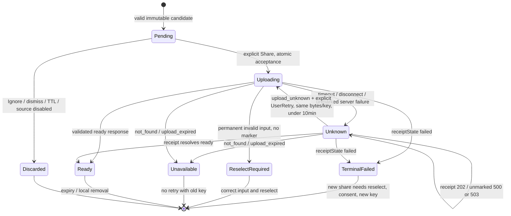

# Share existing screenshots with an explicit desktop action

The proposed companion observes screenshots already produced by the operating system, asks before sharing each image, and returns a link. The web/API and desktop applications live in separate repositories. This document defines behavior; it does not deliver a desktop app or a public API.

## Evidence and decision status

| Status | Meaning here |
| --- | --- |
| Confirmed | User requirement: existing OS capture, screenshot-file detection, optional copied-image detection, Share/Ignore before every upload, Copy/Open after success, separate repositories. |
| Proposed | Rust native core, Tauri 2 settings UI, macOS first, bounds and defaults below, and [HTTP v1](api/uploadimg-v1.md). Parent architecture decisions for implementation planning. |
| Externally documented | Tauri architecture and Apple interfaces described in the references below. Documentation does not establish app integration. |
| Not verified | Native detection/provenance, pasteboard privacy behavior, notification action presentation, packaging, supported OS/CPU matrix, public API/storage deployment. |

The existing local API is not the proposed public v1 API. Current local tooling is separate from native/runtime and public-service proof. Implementation remains subject to the [phased plan](desktop-implementation-plan.md).

## User flow

1. The user selects a screenshot directory. The app establishes a baseline and observes new events.
2. A stable, valid image becomes an immutable, bounded candidate. If clipboard detection is enabled, a supported copied image can create a candidate too.
3. A generic notification offers **Compartir** and **Ignorar**. Opening its body shows a preview; it never uploads.
4. Only **Compartir** authorizes that candidate's upload. Ignoring, dismissing, timeout, denied notifications, or Focus never implies consent.
5. Success requests a result notification whose body shows the validated absolute URL, with **Copiar enlace** and **Abrir enlace**. The full URL is also available in the tray/app. Each action is explicit; no automatic clipboard overwrite or browser launch.

The main notification flow needs a macOS native UserNotifications bridge. Tauri documents its notification Actions API as mobile-only. A grouped result notification is acceptable; the OS controls replacement and presentation. If native actions cannot meet the flow, stop at the feasibility gate and propose a visible popover fallback for product review. Do not silently substitute it.

Proposed Spanish messages:

| State | Text and actions |
| --- | --- |
| Candidate | `Imagen lista para compartir` — `Compartir`, `Ignorar` |
| Uploading | `Subiendo imagen…` |
| Ready | `Enlace listo` with validated absolute URL in the body — `Copiar enlace`, `Abrir enlace` |
| Stale candidate | `Esta imagen ya no está disponible. Vuelve a seleccionarla.` |
| Oversize | `La imagen supera el límite permitido. Selecciona una imagen más pequeña.` |
| Unknown result | `No se ha podido confirmar la subida.` — `Consultar resultado` |
| Eligible unknown receipt | `No se ha podido confirmar la subida.` — `Reintentar`, `Ignorar` |
| Terminal failure | `No se ha podido subir la imagen. Selecciona la imagen de nuevo para compartirla.` |
| Clipboard denied | `El sistema no permite leer imágenes copiadas. Usa el pegado explícito o revisa los permisos.` |
| Notifications denied | `Las notificaciones están desactivadas. Revisa las imágenes pendientes desde el icono de la aplicación.` |

Notification titles are generic and thumbnails disabled. The OS controls result-body previews, truncation and lock-screen presentation; respect its preview settings and do not promise that the link is hidden when the user enables previews. Full screenshot previews stay inside the application. D1 must prove visible URL, result actions and grouped-notification behavior; in-place notification updates are not promised.

## Repository and component ownership

| Owner | Responsibilities | Boundary |
| --- | --- | --- |
| `uploadimg` web/API repository | Web UI, public adapter, image processing, private storage, access expiry, receipts, abuse/operator handling, API schema and fixtures | Owns and publishes v1 contract artifacts; preserves the local API and its loopback guard until a separately authorized migration. |
| Future `uploadimg-desktop` repository | Rust lifecycle/state machine, macOS file/pasteboard/notification adapters, tray/settings, native transport, local preferences, platform releases | Pins released schema/fixtures and digest. No sibling imports, submodules, server sidecar or cross-repo source coupling. |

Versions are independent. The API release precedes a dependent desktop release; a local native probe can begin earlier with fake transport. V1 accepts additive changes only; breaking changes require v2. Desktop ignores unknown additive response fields but validates required fields and fails safely on unknown error codes.

Proposed components are a Rust candidate/state core, OS adapters, bounded decoder, transport/receipt service, credential-store adapter, and a static Tauri settings WebView. Tray/settings commands cross an explicitly scoped native bridge: source preferences, pause/resume, pending/results queries, validated candidate actions and explicit Copy/Open. WebView content cannot supply arbitrary paths, API origins, clipboard reads, receipt keys or arbitrary URLs to native commands. Secrets and network calls remain in Rust. The core does not require Astro, Node, Sharp or frontend clipboard polling; Node/Sharp may remain on the server.

## Preferences and source behavior

Preferences are per-app local configuration, separate from web localStorage.

| Preference | Proposed default and effect |
| --- | --- |
| Screenshot folder | Unconfigured until explicit setup; watch only the selected directory. No automatic change to OS screenshot location. |
| Copied-image notifications | Off. Enabling covers both copied screenshots and other copied images; universal origin classification is not promised. |
| Launch at login | Off; user action required. |
| Monitoring | Can be paused globally; resume establishes a fresh baseline. |
| Theme | System, with light/dark options. |
| Results | Clear bounded link history explicitly; never retain thumbnails. |

### Screenshot files

Baseline existing contents at start, enable, resume and wake; do not notify or upload retrospectively. New directory events are hints: wait for stable complete writes, validate the file and decode before proposing a candidate. Reject symlinks, path escapes and nonregular files. Never move or delete originals.

Screenshot provenance must be demonstrated through supported metadata or explicit dedicated screenshot-folder configuration. Localized filenames alone are insufficient; a general directory must not turn every new image into a screenshot. Provenance and access behavior are native feasibility gates. Sandboxed distribution may need selected-directory access/bookmarks; do not assume blanket full-disk access.

Freeze the accepted bytes. Replacing a source file after notification must not change what **Compartir** sends. Validate file identity/path access while taking the snapshot; unstable or unsafe input is rejected.

### Copied images

Opt-in uses public NSPasteboard policy, supported types and changeCount as the target SDK allows. Read only image bytes; never inspect text, HTML or URLs, or follow clipboard file references. Clipboard disabled means no content inspection/reading and removal of unapproved clipboard candidates. The app preference is distinct from OS permission.

Programmatic reads can prompt or be denied. Do not keep polling in a way that repeats permission dialogs. On denial, stop this source, expose truthful status and offer an explicit paste fallback. Resume/re-enable/wake takes a new baseline. Respect protected/transient markers when documented public interfaces expose them. Supported types, markers, denied reads and policy behavior must be proven on the target system.

## Candidate lifecycle and bounded resources

| Resource | Proposed bound |
| --- | --- |
| Encoded candidate | 10,000,000 bytes maximum |
| Pending candidates | 3; 30,000,000 encoded bytes total |
| Decoded image | Static image; 16,000,000 pixels and 8,192 pixels per edge maximum |
| Decoder concurrency | One worker with measured memory/time limits |
| Pending lifetime / POST retry window | 10 minutes from candidate creation / first accepted attempt, respectively; accepted bytes are retained at most for that retry window |
| Duplicate-event window | 30 seconds, using canonical decoded pixel identity across sources and bounded hash state |
| Active upload | One |
| Persistent metadata | At most 20 total link/operation entries; ready links removed at image expiry, unresolved receipts retained at most 48 hours; no thumbnails |
| Server receipt ledger | 48 hours from first reservation; no raw input retained |

Native TIFF/raw clipboard input may be decoded under separate memory limits and encoded to PNG. Measure native conversion memory/latency before claiming suitability. Reject output above bounds with an actionable message; do not silently lower quality. Animated images are rejected. The source file and server allowlists are independent: transport uses JPEG, PNG or WebP with matching decoded MIME.

Duplicate events/actions cannot duplicate uploads. Acceptance atomically records explicit consent and freezes the candidate; actions carry opaque candidate/operation IDs, never externally supplied paths or URLs. Once accepted, an upload may finish after pause/source disable; unapproved matching candidates are invalidated. Overflow is summarized in tray count/status without unbounded queues or popups. Recopying intentionally outside the duplicate window may notify again; local deduplication never extends server expiry.

Unapproved bytes live in memory only. There is no raw screenshot disk queue/history or automatic offline upload queue. `receiptState: "failed"` proves a durably recorded terminal failure: never retry POST with that key. Unmarked server failures (500/503, or POST 507 if persistence failed) and timeouts remain Unknown; consult GET receipt, where 202 remains Unknown. Only 404 `upload_unknown` with original bytes still retained and less than 10 minutes since first attempt permits explicit **Reintentar** using the same key/bytes; never automatic POST. Without bytes or after restart, reselect and consent to a new key. Permanently invalid 400/411/413/415/422 input needs correction/reselection, not identical retry. 404 `not_found` and 410 never retry the old key. See the [API recovery table](api/uploadimg-v1.md#client-recovery).

Before the first POST, durably save the accepted operation's receipt key in OS credential storage and its minimal metadata in protected local storage, without image bytes. If saving fails or the 20-entry cap prevents retaining recovery state, inform the user and do not begin transfer; never evict an unresolved receipt to admit another upload. Keys never enter frontend state, logs or URLs.

On crash/restart, unapproved candidates disappear and stale Share actions become unavailable. Reconcile accepted operations through GET receipt without another image transfer; do not automatically repeat POST. An unknown receipt after restart has no retained bytes and requires reselect/reconfirmation with a new key. Recovered ready results preserve original expiry and revalidate availability. Unresolved operation metadata/credentials have a 48-hour maximum local lifetime; successful link entries expire with the image. Cleanup and explicit result clearing remove associated credentials too.

## Privacy and public-service boundary

The image upload contains selected image bytes and declared MIME only: no filename, screenshot path, source app, clipboard text or user identity. API requests originate from Rust over HTTPS to the configured API origin; no developer credentials or static application secret ships with the client. Resolve result `/i/{id}` paths only against the configured web origin and validate scheme, host and exact path before Copy/Open.

Sharing is anonymous and capability-based. Possession of an unguessable image URL grants access until expiry; this is not recipient-restricted messaging. Do not promise image contents are anonymized. URLs, receipt keys, images and clipboard contents are excluded from logs; diagnostics are bounded metadata without sensitive payloads.

Expiry is 24 hours from server publication. Access denial is enforced independently of object cleanup. Rate/capacity controls, durable private storage and receipts, retention, trusted proxy handling, HTTPS, decoder budgets, and an operator response to reports are public-release gates, not established features. CORS limits web origins but does not authenticate native clients or solve abuse. Provider/domain and capacity remain unchosen; local limits are not production capacity estimates.

## Platform and excluded scope

macOS first is proposed. A provisional minimum of macOS 15.4 reflects public pasteboard access-behavior API availability; minimum version and Apple Silicon/Intel support depend on native probe results and are not advertised support. Windows/Linux are deferred. Signing/notarization/distribution are separate future gates.

No new capture engine, global shortcut interception, ScreenCaptureKit integration, editing/annotations, OCR, accounts, billing, public gallery or sync is planned for this MVP.

## Primary references

Research checked by the parent on 2026-10-08; device/runtime behavior remains unverified.

- [Tauri architecture](https://v2.tauri.app/concept/architecture/) and [frontend boundary](https://v2.tauri.app/start/frontend/): Rust/native core and static WebView.
- [Tauri notification actions](https://v2.tauri.app/plugin/notification/#actions): mobile-only Actions API.
- [Apple notification actions](https://developer.apple.com/documentation/usernotifications/unnotificationaction) and [category actions](https://developer.apple.com/documentation/usernotifications/unnotificationcategory/actions): native bridge feasibility surface.
- [Apple File System Events](https://developer.apple.com/documentation/coreservices/file_system_events): directory observation, not screenshot-origin proof.
- [NSPasteboard access behavior](https://developer.apple.com/documentation/appkit/nspasteboard/accessbehavior-swift.enum) and [AppKit pasteboard privacy](https://developer.apple.com/documentation/updates/appkit#macOS-pasteboard-privacy): policy/permission behavior to test.
- [App Sandbox selected-file access](https://developer.apple.com/documentation/security/accessing-files-from-the-macos-app-sandbox): access/bookmarks depend on distribution choice.
- [Tauri distribution](https://v2.tauri.app/distribute/): packaging/signing work remains separate.
